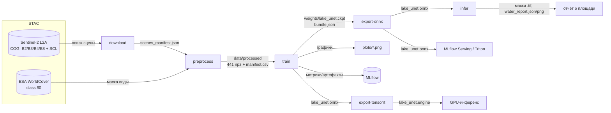

# Как устроен проект

Документ описывает внутреннее устройство: слои пакета, поток данных между стадиями, систему
конфигурации и контракт артефактов. Цель — чтобы новый участник команды мог понять, где что
лежит, и безопасно расширять проект.

## 1. Принципы

1. **Один пакет, один CLI.** Вся логика — в `src/lake_segmentation/`, единственная точка входа —
   `commands.py`. В CLI нет вычислений: метод только собирает конфиг и вызывает функцию из
   соответствующего модуля.
2. **Никаких магических констант.** Физические константы (масштаб reflectance, класс воды,
   классы SCL) лежат в `constants.py`, всё настраиваемое — в Hydra-конфигах.
3. **Конфиг — единственный источник параметров.** Любой прогон воспроизводится парой
   «конфиг + overrides», которые пишутся в MLflow и в `dataset_summary.json`.
4. **Стадии разделены артефактами.** `download → preprocess → train → export → infer` общаются
   только через файлы (`scenes_manifest.json`, `manifest.csv`, `bundle.json`), а не через
   глобальное состояние. Поэтому любую стадию можно перезапустить отдельно.
5. **Импорт без побочных эффектов.** Ни один модуль не выполняет код на уровне файла: только
   определения. Запуск — через `if __name__ == "__main__": main()`.
6. **Инференс не тянет обучение.** Пакет `inference/` зависит от `models/` и `export/`, но не от
   `training/`; для предсказания достаточно `bundle.json` + весов.

## 2. Поток данных



Те же стадии описаны в `dvc.yaml`, поэтому `dvc repro` пересчитывает всю цепочку с контролем
хешей входов и выходов.

## 3. Пакет: что за что отвечает

```
src/lake_segmentation/
├── cli.py              Fire-команды; каждая = compose(config) + вызов функции
├── config.py           загрузка Hydra-конфигов, разрешение путей от корня репозитория
├── constants.py        константы предметной области
├── geo.py              площадь пикселя/маски (UTM и WGS84), изменение площади
├── metrics.py          IoU/Dice/Precision/Recall/Area Error на NumPy (эталон для всего проекта)
├── tiling.py           нарезка растра на тайлы и склейка вероятностей
├── plots.py            все фигуры: превью датасета, кривые обучения, предсказания
├── logging_utils.py    настройка логгера (консоль + файл в plots/)
├── utils.py            seed, stable_seed, git commit, размеры директорий
│
├── data/
│   ├── stac.py          поиск сцен в STAC, выбор лучшей (облачность, покрытие AOI)
│   ├── scenes.py        чтение 4 каналов + SCL окном из COG, паддинг до кратности 256
│   ├── worldcover.py    маска воды WorldCover, мозаика тайлов 3°×3°, репроекция на сетку сцены
│   ├── patches.py       нарезка на патчи, фильтрация по доле воды, отбор негативов
│   ├── splits.py        групповое разбиение по озёрам (70/15/15)
│   ├── normalization.py reflectance, клиппинг, z-score, статистики train
│   ├── dataset.py       torch Dataset + геометрические аугментации
│   ├── dvc_utils.py     dvc pull/push через Python API
│   ├── example.py       генерация примера пары GeoTIFF для демо инференса
│   ├── gdal_env.py      настройки GDAL для чтения удалённых COG
│   └── pipeline.py      стадии download и preprocess (оркестрация)
│
├── models/
│   ├── unet.py          фабрика модели, обёртки, группы параметров encoder/decoder
│   ├── losses.py        BCE + soft Dice
│   └── bundle.py        bundle.json: сборка, сохранение, загрузка
│
├── training/
│   ├── module.py        LightningModule: прямой проход, лосс, метрики, оптимизатор, шедулер
│   ├── datamodule.py    LightningDataModule над манифестом датасета
│   ├── metrics.py       streaming-метрики (TP/FP/FN) и Relative Area Error
│   ├── callbacks.py     HistoryCallback: история эпох → графики → MLflow
│   ├── loggers.py       MLflowLogger/CSVLogger, health-check сервера, гипepпараметры, git commit
│   ├── train.py         полный цикл обучения + подбор порога + тест + артефакты
│   ├── evaluation.py    сбор вероятностей, тюнинг порога, метрики по озёрам, фигуры
│   └── evaluate.py      команда evaluate (без обучения)
│
├── inference/
│   ├── raster.py        чтение/запись GeoTIFF, проверка совместимости пары, ROI
│   ├── predictor.py     тайловый инференс, backend onnx|torch, склейка
│   ├── report.py        фигура отчёта (RGB | маска | overlay)
│   └── run.py           оркестрация: две даты → площади → ΔS → JSON/PNG/маски
│
├── export/
│   ├── onnx.py          экспорт с сигмоидой, dynamic axes, проверка против PyTorch
│   └── tensorrt.py      вызов trtexec, бенчмарк
│
├── serving/
│   ├── mlflow_model.py  публикация ONNX в MLflow с сигнатурой + пример запроса
│   └── triton.py        генерация model repository и config.pbtxt
│
└── baseline/ndwi.py     подбор порога NDWI на валидации, метрики на тесте
```

## 4. Как команда доходит до кода

```python
# commands.py
from lake_segmentation.cli import main
if __name__ == "__main__":
    main()
```

```python
# cli.py (упрощённо)
class LakeSegmentationCli:
    def train(self, config_name="config", overrides="", config_dir=None):
        cfg = load_config(config_name, overrides, config_dir)   # Hydra compose API
        from lake_segmentation.training.train import run_training
        _print_summary("train", run_training(cfg))
```

`load_config()` (`config.py`) делает три вещи:

1. находит каталог `configs/` (аргумент → переменная окружения → корень проекта);
2. собирает конфиг через `hydra.initialize_config_dir` + `compose`;
3. резолвит интерполяции (`OmegaConf.resolve`).

Пути из `cfg.paths` разрешаются **от корня репозитория** (`find_project_root()` ищет каталог с
`pyproject.toml` и `configs/`), поэтому команды работают из любого CWD.

## 5. Конфигурация (Hydra)

Иерархия — одна группа на стадию:

```
configs/
├── config.yaml            корень: defaults, seed, paths, hydra
├── data/default.yaml      STAC, WorldCover, список 12 AOI, параметры патчей, DVC
├── preprocess/default.yaml  reflectance, клиппинг, доли сплита, число превью
├── model/unet_resnet34.yaml архитектура и encoder
├── train/default.yaml     гиперпараметры, лосс, шедулер, чекпоинты, early stopping
├── infer/default.yaml     backend, порог, тайлинг, ROI, выходные файлы
├── export/onnx.yaml       opset, dynamic axes, имена входов/выходов, допуск валидации
├── tensorrt/default.yaml  trtexec, fp16, workspace
├── serving/mlflow.yaml    хост/порт, имя модели, путь к файлу с URI
├── triton/default.yaml    model repository, батчинг, формы
├── mlflow/default.yaml    tracking_uri, эксперимент, fallback
└── baseline/ndwi.yaml     сетка порогов, путь отчёта
```

Примеры переопределений:

```bash
python commands.py preprocess --overrides="data.patch.negative_ratio=0.2"
python commands.py train --overrides="train.max_epochs=40,train.batch_size=16,train.precision=16-mixed"
python commands.py infer --image-a a.tif --overrides="infer.backend=torch,infer.tile_overlap=32"
```

Добавить новую настройку просто: положите ключ в YAML и прочитайте `cfg.<группа>.<ключ>` в коде.
Добавить новую стадию — создайте `configs/<новая_группа>/default.yaml`, добавьте её в
`defaults` корневого конфига и метод в `cli.py`.

Полный резолвнутый конфиг всегда можно посмотреть: `python commands.py show-config`.

## 6. Артефакты и их контракт

| Артефакт                           | Кто пишет                   | Кто читает                                         | Что внутри                                                      |
| ---------------------------------- | --------------------------- | -------------------------------------------------- | --------------------------------------------------------------- |
| `data/raw/scenes_manifest.json`    | `download`                  | `preprocess`                                       | item_id, дата, облачность, EPSG, ссылки на assets               |
| `data/processed/manifest.csv`      | `preprocess`                | `train`, `evaluate`, `baseline`                    | patch_id, split, озеро, сцена, `water_fraction`, transform, CRS |
| `data/processed/patches/*.npz`     | `preprocess`                | `train`                                            | `image` (4,256,256) uint16, `mask` (256,256) uint8              |
| `data/processed/norm_stats.json`   | `preprocess`                | `train`, `evaluate`                                | mean/std по каналам (только train)                              |
| `weights/lake_unet.ckpt`           | `train`                     | `export-onnx`, `evaluate`, `infer` (backend torch) | state_dict + порог                                              |
| `weights/bundle.json`              | `train`                     | **все** стадии инференса/экспорта                  | архитектура, нормализация, порог, tile size, метрики            |
| `weights/lake_unet.onnx`           | `export-onnx` (или `train`) | `infer` (backend onnx), MLflow, Triton             | граф с сигмоидой, метаданные                                    |
| `plots/*.png`, `plots/history.csv` | `train`                     | люди, MLflow                                       | кривые, предсказания, превью                                    |
| `predictions/*`                    | `infer`                     | люди                                               | маски, JSON-отчёт, картинка                                     |

**bundle.json — ключевой контракт.** Он связывает данные, модель и инференс: если поменять
порядок каналов или способ нормализации, инференс узнает об этом только из bundle. Поэтому
`export-onnx` и `infer` всегда начинают с его загрузки, а не с констант в коде.

## 7. Соглашения

- **Пути** — только `pathlib`, никаких `os.path`.
- **Переменные** — осмысленные имена; однобуквенные допустимы только для индексов.
- **Логи** — через `get_logger(__name__)`, файл пишется в `plots/train.log`.
- **Предупреждения не подавляются** (`warnings.filterwarnings` в проекте нет).
- **Сид** — `utils.seed_everything(cfg.seed)`; для стохастики отбора патчей — `utils.stable_seed`
  (SHA-256), потому что встроенный `hash()` солится процессом.
- **Импорты** — тяжёлые (`torch`, `lightning`) импортируются внутри функций там, где это
  ускоряет лёгкие команды; на уровне модуля — только то, что нужно определению.

## 8. Точки расширения

| Задача                 | Что сделать                                                                                                                                                               |
| ---------------------- | ------------------------------------------------------------------------------------------------------------------------------------------------------------------------- |
| Другая архитектура     | положить YAML в `configs/model/` (`architecture`, `encoder_name`, `in_channels`, `classes`); `models/unet.py::build_model` возьмёт класс из `segmentation-models-pytorch` |
| Новый источник снимков | реализовать функцию чтения, возвращающую `BandStack` (см. `data/scenes.py`), и подменить вызов в `data/pipeline.py`                                                       |
| Другая разметка        | заменить `data/worldcover.py::read_water_mask` — интерфейс «сетка сцены → bool-маска»                                                                                     |
| Новый лосс             | добавить класс в `models/losses.py` и выбрать его в `training/module.py` по конфигу                                                                                       |
| Новая метрика          | добавить определение в `metrics.py` (NumPy) и, если нужна потоковая, в `training/metrics.py` — тест `tests/test_imports.py` сверяет их                                    |
| Новый бэкенд инференса | реализовать `_forward` в `inference/predictor.py` (интерфейс: батч NCHW → вероятности)                                                                                    |
| Новый тип отчёта       | расширить `inference/run.py` (JSON собирается в одном месте)                                                                                                              |
